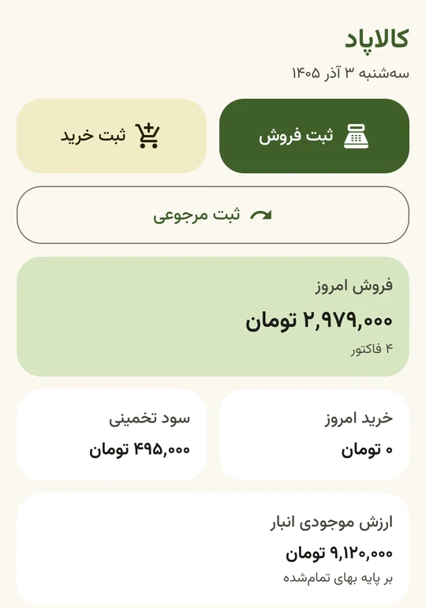
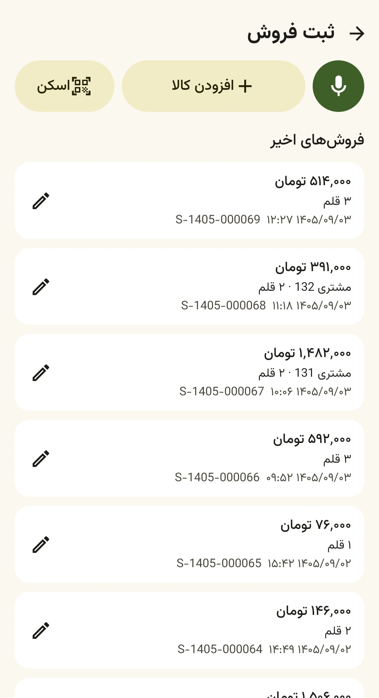
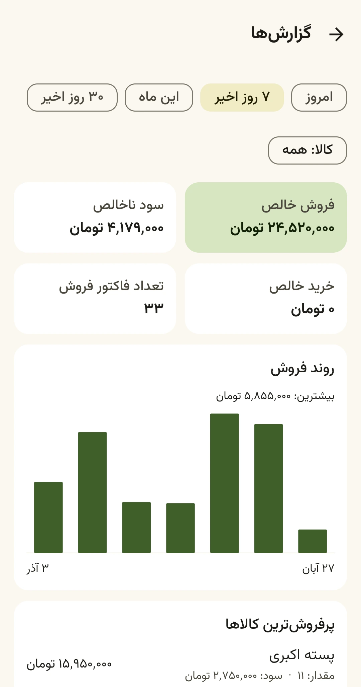

<div dir="rtl">

<p align="center">
  
</p>

<h1 align="center">کالاپاد</h1>
<p align="center"><b>مدیریت هوشمند فروشگاه، با صدای خودتان</b><br>
ثبت خرید و فروش در چند ثانیه با صدا، بارکد یا دست. فارسی، آفلاین، روی گوشی خودتان.</p>

<p align="center">
  <a href="https://github.com/shared-exp/Kalapod/releases/latest/download/Kalapod.apk"><b>دانلود برای اندروید</b></a> ·
  <a href="https://shared-exp.github.io/Kalapod/">وب‌سایت</a>
</p>

<p align="center">
  
  
  
</p>

---

## فهرست

- [کالاپاد برای چه کسی است؟](#کالاپاد-برای-چه-کسی-است)
- [ویژگی‌ها](#ویژگیها)
- [نصب](#نصب)
- [راهنمای کار با برنامه](#راهنمای-کار-با-برنامه)
  - [ورود کالا (خرید)](#ورود-کالا-خرید)
  - [فروش](#فروش)
  - [ثبت با صدا](#ثبت-با-صدا)
  - [خرید کارتنی](#خرید-کارتنی)
  - [بارکد](#بارکد)
  - [مرجوعی، ویرایش و ابطال](#مرجوعی-ویرایش-و-ابطال)
  - [نسیه، مشتری و تأمین‌کننده](#نسیه-مشتری-و-تأمینکننده)
  - [انبار و قیمت هر بار](#انبار-و-قیمت-هر-بار)
  - [گزارش‌ها و پیشنهاد خرید](#گزارشها-و-پیشنهاد-خرید)
  - [پشتیبان‌گیری](#پشتیبانگیری)
- [سؤال‌های رایج](#سؤالهای-رایج)
- [ساخت از کد منبع](#ساخت-از-کد-منبع)

---

## کالاپاد برای چه کسی است؟

برای مغازه‌دارهایی که وقت پر کردن فرم ندارند: **سوپرمارکت، خواربارفروشی، آجیل و خشکبار** و هر فروشگاه کوچک دیگری که می‌خواهد بداند چه فروخته، چه دارد، چقدر سود کرده و چه چیزی باید بخرد.

یک صاحب‌مغازه، یک فروشگاه، یک گوشی اندروید. اطلاعات فروشگاه هیچ‌وقت از گوشی بیرون نمی‌رود.

## ویژگی‌ها

| | |
|---|---|
| 🎙️ **ثبت با صدا** | «دو تا روغن لادن و یه کیلو برنج فروختم»؛ چند کالا در یک جمله، اعداد فارسی، قیمت «کیلویی» و «دونه‌ای»، تشخیص اسم حتی با اشتباه شنیداری |
| 📷 **بارکد** | اسکن پشت‌سرهم با دوربین (بدون اینترنت)، چند بارکد برای یک کالا، تعریف فوری کالای ناشناخته |
| 📦 **انبار دقیق** | موجودی از روی سابقهٔ ورود و خروج حساب می‌شود، نه یک عدد دستی؛ هشدار کم‌شدن موجودی |
| 🏷️ **قیمت هر بار** | هر خرید با قیمت خرید و فروش خودش؛ اول بار قدیمی با قیمت خودش فروخته می‌شود، بعد قیمت بار جدید |
| 🗃️ **کارتن و باکس** | «ده کارتن دوازده تایی» یعنی ۱۲۰ عدد در انبار، ولی در فاکتور و انبار کارتنی نوشته می‌شود |
| 🧾 **فاکتور** | شماره‌گذاری خودکار، PDF فارسی برای چاپ و ارسال، تاریخچهٔ خرید و فروش |
| ↩️ **مرجوعی و ویرایش** | مرجوعی خرید و فروش، ویرایش فاکتور فروش، ابطال سند؛ هیچ سندی بی‌صدا پاک نمی‌شود |
| 🤝 **نسیه و حساب‌ها** | نقد، کارت و نسیه؛ پرداخت بخشی؛ بدهی مشتری‌ها و طلب تأمین‌کننده‌ها |
| 📊 **گزارش و سود** | فروش، خرید، سود واقعی، پرفروش‌ترین‌ها، ارزش انبار و نمودار روند فروش |
| 🔮 **پیشنهاد خرید** | چه چیزی، چقدر و کی؛ از روی سرعت فروش، روزهای هفته و زمان رسیدن جنس |
| 🔒 **پشتیبان رمزدار** | پشتیبان خودکار و دستی، بازیابی بعد از نصب دوباره، و اضافه کردن پشتیبان قدیمی به اطلاعات فعلی |
| 🌗 **ظاهر** | فارسی و راست‌به‌چپ، تقویم شمسی، فونت وزیرمتن، تم روشن و تیره، دکمه‌های بزرگ |

## نصب

1. فایل `Kalapod-*.apk` را از [آخرین نسخه](https://github.com/shared-exp/Kalapod/releases/latest) دانلود کنید.
2. فایل را باز کنید. اگر اندروید پرسید، «نصب از این منبع» را برای مرورگر یا مدیر فایل مجاز کنید.
3. برنامه را باز کنید. اگر قبلاً پشتیبان داشته‌اید، صفحهٔ اول پیشنهاد بازیابی می‌دهد.

نیازمندی: اندروید ۸ یا بالاتر. نسخهٔ نصب‌شده را در **بیشتر ← تنظیمات** (پایین صفحه) ببینید.

## راهنمای کار با برنامه

برنامه سه بخش دارد: **خانه**، **انبار** و **بیشتر**. دکمه‌های بزرگ صفحهٔ اصلی «ثبت فروش»، «ثبت خرید» و «ثبت مرجوعی» هستند.

### ورود کالا (خرید)

هر کالایی فقط از راه خرید وارد انبار می‌شود، پس هیچ کالایی با موجودی صفر ثبت نمی‌شود.

1. **انبار ← ورود کالا (خرید)** یا در صفحهٔ اصلی **ثبت خرید**.
2. کالا را اضافه کنید: با میکروفون، با «افزودن کالا» از فهرست، یا با «اسکن».
3. کالای جدید؟ «تعریف کالای جدید» را بزنید. فرم با تعداد خرید، قیمت خرید و قیمت فروش باز می‌شود و بعد از ذخیره، کالا مستقیم به سبد می‌آید.
4. در صورت نیاز تخفیف، هزینهٔ جانبی (کرایه)، تأمین‌کننده و نحوهٔ پرداخت را بنویسید و **ثبت خرید** را بزنید.

در صفحهٔ خرید، وقتی سبد خالی است، **تاریخچهٔ خریدها** نمایش داده می‌شود.

### فروش

1. صفحهٔ اصلی ← **ثبت فروش**.
2. کالاها را با صدا، فهرست یا بارکد اضافه کنید؛ قیمت فروش خودکار پر می‌شود.
3. نحوهٔ دریافت (نقد، کارت یا نسیه) را انتخاب کنید و **ثبت فروش** را بزنید.

- **فروش بیشتر از موجودی:** اگر خرید اشتباه یا ناقص ثبت شده باشد، برنامه یک بار تأیید می‌گیرد و فروش را ثبت می‌کند. موجودی منفی در صفحهٔ اصلی با «اصلاح کنید» نشان داده می‌شود و با ثبت خرید یا شمارش انبار درست می‌شود. وقتی خرید ثبت شد، سود آن فروش هم خودکار اصلاح می‌شود.
- **تاریخچه:** وقتی سبد خالی است، فهرست همهٔ فروش‌ها نمایش داده می‌شود. روی هر فروش بزنید تا فاکتورش باز شود، یا روی ✏️ تا ویرایش شود.

### ثبت با صدا

دکمهٔ میکروفون را بزنید و عادی حرف بزنید:

| می‌گویید | برنامه می‌فهمد |
|---|---|
| «دو تا روغن لادن و یه کیلو برنج فروختم» | دو قلم، با تعداد و واحد هر کدام |
| «یه روغن لادن یه پنیر صبا» | دو قلم جدا، حتی بدون «و» |
| «سه کیلو پسته، کیلویی یک میلیون و دویست» | قیمت هر کیلو |
| «۱۰ تا رب ۷۰۰ چین چین» | رب ۷۰۰ گرمی (اندازه جزو اسم کالاست) |
| «یه ربع کیلو پسته» | ۲۵۰ گرم |
| «نسیه به آقای رضایی» | فروش نسیه به نام آن مشتری |

- **اسم کلی:** اگر گفتید «رب» و چند نوع رب دارید، برنامه می‌پرسد «کدام رب؟» و گزینه‌ها را به ترتیب پرفروش‌ترین نشان می‌دهد. با یک لمس انتخاب کنید.
- **کالای جدید:** در خرید، اگر اسم دقیقاً یکی از کالاها نبود، برنامه حدس نمی‌زند؛ نزدیک‌ترین‌ها را نشان می‌دهد و گزینهٔ «کالای جدید است» را هم دارد.
- **تأیید:** قبل از افزودن به سبد، خلاصه را می‌بینید و می‌توانید هر قلم را حذف یا اصلاح کنید.
- **حالت آنلاین و آفلاین:**
  - **آنلاین:** تشخیص صدا دقیق‌تر است و صدا به سرویس تشخیص گفتار گوشی فرستاده می‌شود. اطلاعات فروشگاه فرستاده نمی‌شود.
  - **آفلاین:** یک بار بستهٔ فارسی (حدود ۶۲ مگابایت) دانلود می‌شود. انتخاب در «تنظیمات» است.

### خرید کارتنی

- **با صدا:** «ده تا کارتن دوازده تایی کیک نادری» یعنی ۱۲۰ عدد کیک وارد انبار می‌شود. در سبد، فاکتور و انبار «۱۰ کارتن (۱۲۰ عدد)» نوشته می‌شود.
- **کلمه‌ها:** کارتن، کارتون، باکس، بُکس، بوکس و جعبه همه کارتن حساب می‌شوند.
- **تعداد داخل کارتن:** اگر نگفتید، برنامه می‌پرسد «هر کارتن چند تا داره؟». جواب برای همان کالا ذخیره می‌شود و دفعهٔ بعد پرسیده نمی‌شود.
- **قیمت:** «کارتنی ۴۸۰ هزار» قیمت هر کارتن است. جمع فاکتور دقیقاً تعداد کارتن ضرب در قیمت هر کارتن است.
- **دستی:** در فرم کالا، «هر کارتن/باکس چند عدد؟» را پر کنید. در سبد خرید هم دکمهٔ «خرید کارتنی» بین عددی و کارتنی جابه‌جا می‌کند.

### بارکد

- **اسکن در سبد:** در سبد خرید و فروش «اسکن» را بزنید و بارکدها را پشت‌سرهم بگیرید. اسکن دوباره، تعداد را یکی زیاد می‌کند.
- **کنار هر خانهٔ بارکد:** آیکون دوربین هست؛ در فرم کالا، جست‌وجوی انبار و انتخاب کالا.
- **بارکد ناشناخته:** برنامه پیشنهاد می‌دهد همان لحظه کالا را تعریف کنید.

### مرجوعی، ویرایش و ابطال

- **مرجوعی:**
  1. صفحهٔ اصلی ← **ثبت مرجوعی**.
  2. فاکتور را با شماره یا نام مشتری/تأمین‌کننده پیدا کنید.
  3. فرم مرجوعی همان لحظه باز می‌شود. مقدار برگشتی را بنویسید یا بگویید.
- **ویرایش فروش:** در تاریخچهٔ فروش روی ✏️ بزنید، یا در صفحهٔ فاکتور «ویرایش فاکتور» را بزنید. با ذخیره، فاکتور قبلی باطل می‌شود و فاکتور اصلاح‌شده با **همان تاریخ** ثبت می‌شود.
- **ابطال:** در صفحهٔ هر فاکتور، «ابطال سند» با نوشتن دلیل.
- **هیچ چیز پاک نمی‌شود:** هیچ سندی بی‌صدا پاک نمی‌شود. سند باطل‌شده با خط‌خوردگی می‌ماند و موجودی و پول درست برمی‌گردد.

### نسیه، مشتری و تأمین‌کننده

- **ثبت نسیه:** در فروش، «نسیه» را انتخاب کنید و نام مشتری را بنویسید. می‌شود بخشی از مبلغ را همان لحظه گرفت.
- **حساب‌ها:** در **بیشتر ← مشتریان و تأمین‌کنندگان** مانده و ریز حساب هر کس را ببینید و دریافت و پرداخت ثبت کنید.

### انبار و قیمت هر بار

- **هر بار خرید جداست:** اگر کالایی را دوباره با قیمت متفاوت بخرید، با قیمت قبلی میانگین گرفته نمی‌شود. تا بار قبلی تمام نشده، با قیمت خودش فروخته می‌شود و بعد قیمت بار جدید روی کالا می‌آید.
- **فروش از دو بار:** اگر یک فروش از دو بار بگذرد، سبد هر دو قیمت را نشان می‌دهد، مثلاً «۵ × ۱۱٬۰۰۰ + ۲ × ۱۲٬۰۰۰».
- **شمارش انبار:** در صفحهٔ هر کالا موجودی شمرده‌شده را با دلیل ثبت کنید. سابقهٔ همهٔ ورود و خروج‌ها می‌ماند.
- **حداقل موجودی:** برای هر کالا حداقل موجودی بگذارید تا در صفحهٔ اصلی هشدار بگیرید.

### گزارش‌ها و پیشنهاد خرید

- **بیشتر ← گزارش‌ها:**
  - فروش خالص، خرید، سود ناخالص و تعداد فاکتور
  - نمودار روند فروش و پرفروش‌ترین کالاها
  - بازهٔ امروز، ۷ روز، این ماه یا ۳۰ روز، برای همهٔ کالاها یا یک کالا
- **بیشتر ← پیشنهاد خرید:**
  - کالاهایی که به‌زودی تمام می‌شوند
  - مقدار پیشنهادی خرید، با یک لمس منتقل به صفحهٔ خرید
  - اگر داده کافی نباشد، برنامه صادقانه می‌گوید

### پشتیبان‌گیری

- **کجا:** بیشتر ← پشتیبان‌گیری. پشتیبان با رمز شما قفل می‌شود.
- **پشتیبان خودکار:** پشتیبان روزانه، با نگه داشتن ۷ نسخهٔ آخر. کارت یادآوری اگر خاموش باشد.
- **بعد از نصب دوباره:** فایل پشتیبان در پوشهٔ دانلود می‌ماند و صفحهٔ اول، بازیابی را پیشنهاد می‌دهد.
- **پشتیبان قدیمی بعد از کار با برنامهٔ تازه:**
  - گزینهٔ «اضافه کردن به اطلاعات فعلی» آن را بدون تکرار با اطلاعات فعلی ادغام می‌کند.
  - تاریخ‌ها و شمارهٔ فاکتورهای قدیمی حفظ می‌شوند.

## سؤال‌های رایج

**اینترنت لازم است؟**
خیر. همه‌چیز آفلاین کار می‌کند. فقط تشخیص صدای آنلاین (اختیاری) و دانلود یک‌بارهٔ بستهٔ صدای آفلاین اینترنت می‌خواهند.

**اطلاعاتم کجا ذخیره می‌شود؟**
فقط روی گوشی شما، و در پشتیبان‌های رمزداری که خودتان نگه می‌دارید.

**ریال یا تومان؟**
پیش‌فرض تومان است و در تنظیمات می‌شود ریال را انتخاب کرد. همهٔ مبالغ بدون خطای اعشار حساب می‌شوند.

**با اشتباه چه کنم؟**
فاکتور را ویرایش یا ابطال کنید، یا مرجوعی بزنید. موجودی و حساب‌ها خودکار درست می‌شوند.

## ساخت از کد منبع

نیازمندی‌ها: JDK 17 و Android SDK (API 35).

```bash
git clone https://github.com/shared-exp/Kalapod.git
cd Kalapod
./gradlew assembleDebug        # فایل نصب: Kalapod-v0.N-debug.apk در پوشهٔ اصلی
./gradlew testDebugUnitTest     # تست‌های واحد
./gradlew connectedDebugAndroidTest   # تست‌های روی دستگاه
```

| بخش | فناوری |
|---|---|
| رابط کاربری | Kotlin، Jetpack Compose، Material 3 |
| معماری | MVVM، Hilt |
| پایگاه داده | Room (SQLite) با migration |
| بارکد | CameraX و ML Kit (مدل داخلی، آفلاین) |
| صدا | تشخیص گفتار اندروید (آنلاین) و Vosk (آفلاین) |
| فاکتور | Android PdfDocument |
| پشتیبان | AES-256-GCM، WorkManager |

شمارهٔ نسخه در `version.properties` است.

## مجوزها

فونت وزیرمتن تحت مجوز SIL Open Font License 1.1؛ جزئیات در [`docs/THIRD_PARTY.md`](docs/THIRD_PARTY.md).

</div>
